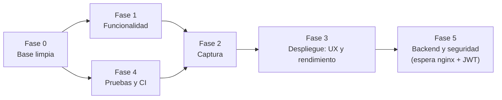

# Plan de mejoras del código

**Fecha:** 2026-10-07 · **Origen:** [`revision_de_codigo.md`](../05_desarrollo_y_especificaciones_tecnicas/revision_de_codigo.md) (hallazgos `H-NN`)  
**Estado (2026-10-07):** Fase 0 ejecutada salvo MEJ-06 (decidido el 2026-10-15: **no borrar** los archivos sin uso; se conservan). Fase 1 ejecutada salvo MEJ-11 (diferida por decisión: las landings se mantienen inertes, están en el roadmap) y MEJ-12 (decidido el 2026-10-15: **solo aplicación Web**; no se requieren `applicationId`, SHA-256 ni `TEAM_ID`; queda verificar el flujo en el servidor Web). Fases 2–5 siguen como propuesta. La migración de Flutter a *nginx + API + JWT* queda **fuera de este plan** hasta que esa configuración esté lista (Fase 5).

**Esfuerzo (relativo):** **S** ≤ medio día · **M** 1–3 días · **L** 1–2 semanas. **Prioridad:** P1 (hacer ya), P2 (siguiente), P3 (cuando haya espacio).  
**Regla de entrega:** cada tarea termina con `flutter analyze` sin errores nuevos, `flutter test` verde y la documentación afectada actualizada (columna *Docs*), verificada con `verificar_documentacion.py`.

## Orden recomendado

## Fase 0 — Base limpia (primero: reduce ruido y riesgo)

**Resultado:** `flutter analyze` pasó de 46 hallazgos a **0**; `flutter test` pasó de 1 prueba fallida a **9 pruebas en verde**; `lib/` pasó de 68.875 a 50.690 líneas (−18.200 líneas de código comentado). MEJ-05 cambia comportamiento de dos pantallas (esquema de colores y reordenar fotos): **probar a mano**. MEJ-06 queda pendiente.

| ID | Tarea | Hallazgos | Esf. | Prior. | Criterio de aceptación | Docs |
| :--- | :--- | :--- | :---: | :---: | :--- | :--- |
| MEJ-01 ✅ `33a80df` | Corregir `_BurbujaMensaje`: recibir `currentUserId`, calcular `isMe`, alinear/colorear los mensajes propios | H-01 | S | **P1** | En un grupo, mis mensajes salen a la derecha y sin nombre; desaparecen los 5 `dead_code` de `page_chat_grupo.dart` | SDD_grupos, Gherkin `chat_grupo.feature` |
| MEJ-02 ✅ `d902d39` | Sustituir la prueba de plantilla por una prueba de arranque real (o por una de `routeGenerate`) y dejar `flutter test` en verde | H-22 | S | **P1** | `flutter test` pasa | `estrategia_de_pruebas…` |
| MEJ-03 ✅ `d7a9e7d` | Eliminar imports sin uso, variables sin uso e imports innecesarios | H-24 | S | P1 | Avisos `unused_*`/`unnecessary_import` = 0 | — |
| MEJ-04 ✅ `594e138` | Eliminar el código comentado (≈10.100 líneas en bloques `/* */`) — git conserva el historial; empezar por `form_update_espacio_comprado` y `form_crea_ficha_captura_propiedad` | H-24, H-12 | M | P1 | Archivos sin versiones antiguas comentadas; la app compila y las pantallas afectadas se prueban a mano | Epics ESP-009, inventarios, `dominios_modulos_archivos` |
| MEJ-05 ✅ `4280f6c` | Migrar `Radio` a `RadioGroup` (`pagina_colores`) y `onReorder` → `onReorderItem` | H-21 | S | P2 | `deprecated_member_use` = 0 | SDD `04_provider`, `22_imagenes` |
| MEJ-06 ❌ no se ejecuta (decisión: no borrar) | Decidir y retirar archivos sin uso (`ui_exceptions`, `encriptar` tras confirmar que no hay datos cifrados, `genera_cantidad_monetaria`) | H-09 | S | P3 | Archivos eliminados o documentados como vigentes | inventarios, `40_security`, `indice_archivos_modelos` |

## Fase 1 — Funcionalidad: decidir y cerrar lo incompleto

**Decisiones (2026-10-07):** se implementa la exportación a PDF; las landings (`03_vistas`) se mantienen inertes porque esas secciones están en el roadmap; el resto (acciones de la ficha, eliminar miembro/contacto, ruta de error) se implementó según la propuesta del plan.
**Resultado:** `flutter analyze` sin hallazgos; **16 pruebas en verde** (antes 9). Durante la fase se encontraron y corrigieron tres defectos de navegación que la revisión no había detectado: tras cambiar la contraseña la app navegaba a `/login` (ruta inexistente), agregar/editar foto navegaba a rutas sin pantalla, y la ficha de propiedad se mostraba sin `Scaffold` (ni botón de regreso). **Probar a mano:** ficha (barra de acciones y PDF en Web y móvil), eliminar miembro/contacto, agregar/editar foto desde las vistas de lista y carrusel, y el flujo completo de recuperación de contraseña.
**MEJ-12 (alcance Web, 2026-10-15):** los enlaces móviles (App Links/Universal Links) quedan fuera; la configuración existente en `AndroidManifest.xml` y `Runner.entitlements` no se usa ni se completa. Pendiente solo verificar en el servidor Web que `/recuperar?token=…&perfil=…` cargue la app y que `DEEP_LINK_BASE` coincida con ese host.

Cada punto requiere una **decisión de producto** (implementar o retirar del alcance) antes de programar.

| ID | Tarea | Hallazgos | Esf. | Prior. | Criterio de aceptación | Docs |
| :--- | :--- | :--- | :---: | :---: | :--- | :--- |
| MEJ-07 ✅ `764cbfc` | Cablear «Exportar PDF» en la ficha de propiedad (botón → `PdfGeneratorService.generarYDescargarPDF`) **o** eliminar el servicio | H-03 | M | P2 | Desde la ficha se genera el PDF en Web y móvil, o el código se retira | REQ-PROP-007, US-PROP-004, Gherkin |
| MEJ-08 ✅ `764cbfc` | Unificar las acciones de la ficha: «Contactar», «Compartir», «Guardar en lista» en `PaginaDetalleWidget` (reutilizar los diálogos de `03_listas`) y usar `fromChatUserId` | H-04 | M | P2 | Las tres acciones disponibles en la ficha; el carrusel las reutiliza sin duplicar | REQ-PROP-004..006, US-PROP-003 |
| MEJ-09 ✅ `29751ea` | Mostrar `PaginaDeError`/diálogo cuando falte el permiso de ubicación y registrar `onUnknownRoute`; eliminar las 16 constantes de ruta sin pantalla | H-05, H-08 | S | P2 | Sin permiso se informa al usuario; ruta desconocida muestra la página de error | REQ-ROUT-006/012, SDD_07_routes, Gherkin `07_routes` |
| MEJ-10 ✅ `f16cba5` | Implementar «Eliminar miembro» (admin) y «Eliminar contacto», o retirarlos del alcance | H-06 | M | P3 | Operaciones disponibles con confirmación; Gherkin `@pendiente` pasa a verde | REQ-GPU-016, US-GPU, conocidos |
| MEJ-11 ⏸ diferida | Landings (`03_vistas`): cablear o quitar botones y el formulario de inmobiliarias (enviar a un endpoint o a correo); quitar «PROXIMAMENTE» | H-02 | M | P2 | Ningún `onPressed: () {}` en pantallas publicadas | Epic/US `03_vistas` |
| MEJ-31 ✅ `7e3c8ce` | Implementar las burbujas de propiedad y de lista en el chat de grupo (hoy son `SizedBox.shrink()`); reutilizar las de `page_chat_privado.dart` en un widget compartido | H-27 | M | P2 | Tocar una propiedad o lista compartida en un grupo abre su detalle; escenarios `@pendiente` de `chat_grupo.feature` en verde | REQ-GPU-010, SDD_grupos, Gherkin |
| MEJ-12 🔄 alcance Web | ~~App Links/Universal Links móviles~~ (fuera de alcance por decisión). Verificar en Web la recuperación de contraseña de extremo a extremo: el servidor debe devolver `index.html` para `/recuperar` y `DEEP_LINK_BASE` del mailer debe apuntar al host que sirve la app | H-07 | M | P2 | El enlace del correo abre la app en Android/iOS y cambia la contraseña | runbook §5, REQ-ROUT-007/008 |

## Fase 2 — Pantallas de captura

| ID | Tarea | Hallazgos | Esf. | Prior. | Criterio de aceptación | Docs |
| :--- | :--- | :--- | :---: | :---: | :--- | :--- |
| MEJ-13 ✅ `ff40269`, `809bf50` | Crear un widget de campo común (`CampoTexto`) con `keyboardType`, `inputFormatters`, `validator` y mensajes uniformes; usarlo en registro, edición de propiedad y compra | H-10, H-11 | M | P1 | Teléfono, precio y metros usan teclado numérico y formato; los errores aparecen junto al campo | SDD_tus_espacios, SDD_10_user_login, `antigravity_ui_rules` |
| MEJ-14 ✅ `ff40269` | Partir `PaginaEditaEspacio` en un widget por paso (`PasoPropiedad`, `PasoPrecio`, `PasoUbicacion`, `PasoAdicionales`, `PasoContacto`) con su propia validación y un `Notifier` de borrador | H-12, H-11 | L | P2 | Ningún archivo > 800 líneas; validar por paso antes de avanzar; pruebas de widget por paso | REQ-ESP-004/013/009, SDD_tus_espacios |
| MEJ-15 ✅ `bf6000d` | Dividir `form_crea_ficha_captura_propiedad` (tarjeta) y renombrarlo (`ficha_propiedad_card.dart`); mover lógica de publicar/despublicar a un servicio | H-12 | M | P2 | Tarjeta < 400 líneas; publicar/despublicar con reversión cubiertos por prueba unitaria | REQ-ESP-003/012/014, inventarios |
| MEJ-16 ✅ `809bf50` (doble envío; *debounce* pendiente) | Evitar doble envío (deshabilitar botones mientras se procesa) y agregar *debounce* a búsquedas | H-14 | S | P2 | Un toque doble no duplica documentos; la búsqueda no consulta en cada pulsación | SDD afectados |
| MEJ-17 | Mover `tabla_tipopropiedad_vs_campos` a un modelo de configuración (JSON/CouchDB) | H-13 | M | P3 | Un tipo nuevo se añade sin recompilar | REQ-ESP-005/010 |

## Fase 3 — Pantallas de despliegue: UX, accesibilidad y rendimiento

| ID | Tarea | Hallazgos | Esf. | Prior. | Criterio de aceptación | Docs |
| :--- | :--- | :--- | :---: | :---: | :--- | :--- |
| MEJ-18 🔄 parcial `d864405` | Reemplazar `Color(0x…)`/`Colors.*` por `appTheme` (empezar por `03_vistas` y `form_crea_ficha…`); revisar contraste en los 8 temas | H-17 | M | P2 | Búsqueda de `Colors.` fuera de `20_var_globales` ≈ 0 (excepciones documentadas en `ui_exceptions`) | `antigravity_ui_rules`, `var_color_themes` |
| MEJ-19 🔄 parcial `2630c27`, `1c1d262` | Accesibilidad: `Semantics`/`semanticLabel` en imágenes y botones de ícono, probar con `TextScaler` 1.3× y lector de pantalla | H-16 | M | P2 | Recorrido de login → detalle → lista sin truncados ni controles sin etiqueta | `antigravity_ui_rules`, Gherkin `general_usabilidad` |
| MEJ-20 🔄 parcial `1c1d262` | Un patrón único para carga/error/vacío (`AsyncValueWidget` sobre `stateWaiting`/`stateError…`) y migrar los `FutureBuilder` más usados a providers | H-19, H-20 | L | P3 | Mismas pantallas de estado en todos los listados; `RefreshIndicator` en listas largas | `60_global_widgets`, SDD afectados |
| MEJ-21 | **Medir** el rendimiento de listados con fotos (DevTools) y, si se confirma, usar `cacheWidth/cacheHeight`, miniaturas y carga perezosa | H-18 | M | P2 | Desplazamiento del catálogo sin caídas de fotogramas en un dispositivo de gama media | SDD `22_imagenes`, `08_pantallas_inicio` |

## Fase 4 — Pruebas y CI (en paralelo desde la Fase 0)

| ID | Tarea | Hallazgos | Esf. | Prior. | Criterio de aceptación | Docs |
| :--- | :--- | :--- | :---: | :---: | :--- | :--- |
| MEJ-22 | Pruebas unitarias: `generate_hash`, `generate_reset_token/isTokenValid`, `routeGenerate`, `_navigateIfRecovery`, modelos Freezed | H-22 | M | **P1** | ≥ 70 % de líneas en `40_security` y `07_routes` | `estrategia_de_pruebas…` |
| MEJ-23 | Pruebas de providers con cliente HTTP simulado (sesión, conocidos, grupos, listas) | H-22 | L | P2 | ≥ 50 % en módulos nivel A | idem |
| MEJ-24 | CI (GitHub Actions u otro): `flutter analyze`, `flutter test`, `verificar_documentacion.py` en cada PR | H-22 | M | P2 | PR bloqueado si falla alguno | guía SDLC §Mantenimiento |
| MEJ-25 | Pruebas de integración de los flujos críticos (login, recuperación, búsqueda, editar y publicar) ligadas a los `.feature` con tag `@REQ-*` | H-22 | L | P3 | Los escenarios marcados «crítico» se ejecutan en CI | Gherkin, matriz |

## Fase 5 — Red, backend y seguridad (depende de nginx + JWT)

| ID | Tarea | Hallazgos | Esf. | Prior. | Criterio de aceptación | Docs |
| :--- | :--- | :--- | :---: | :---: | :--- | :--- |
| MEJ-26 | Capa HTTP única (cliente con *timeout*, reintento, mapeo de errores) y migrar los 133 puntos de llamada de forma gradual; hacerla antes de la migración facilita el cambio a JWT | H-23 | L | P2 | Ninguna llamada `http.*` fuera de la capa; todas con *timeout* | `contrato_api_actual`, SDD afectados |
| MEJ-27 | Mailer: autenticación entre servicios, CORS restringido, escape de HTML y HTTPS | T5–T7 | M | **P1** | Pruebas de `curl` sin credencial → 401; plantilla escapa `nombreUsuario` | `contrato_api_actual`, `modelo_de_amenazas`, runbook |
| MEJ-28 | **Migración Flutter → nginx → API → JWT** (pendiente de configuración): sacar credenciales de CouchDB del cliente, autorización por usuario, `Dio` con interceptor | H-26, T1–T4 | L+ | **P1 cuando esté lista** | La app no contiene credenciales de CouchDB; OpenAPI publicado | todo: arquitectura, ADR-006, contrato, amenazas, SDD, Epics |
| MEJ-29 | Versionar *design documents* de CouchDB en `db/design/` y respaldo automático probado | — | M | P2 | Restauración probada en entorno de prueba | runbook §2, `06_modelo_de_datos` |
| MEJ-30 | Reducir los registros (`debugPrintLevels`) en producción y no registrar argumentos de navegación | H-25, T10 | S | P3 | Compilación *release* sin registros de argumentos | SDD_07_routes |

## Resumen de esfuerzo y dependencias

| Fase | Tareas | Esfuerzo aproximado | Depende de |
| :--- | :--- | :--- | :--- |
| 0 | MEJ-01…06 | ≈ 1 semana | — |
| 1 | MEJ-07…12, MEJ-31 | ≈ 2–3 semanas | Decisiones de producto |
| 2 | MEJ-13…17 | ≈ 3–4 semanas | Fase 0 (código limpio) y MEJ-13 antes de MEJ-14 |
| 3 | MEJ-18…21 | ≈ 3 semanas | Medición (MEJ-21) antes de optimizar |
| 4 | MEJ-22…25 | continuo (≈ 1 semana inicial + 1 por flujo) | — |
| 5 | MEJ-26…30 | MEJ-27 ya; MEJ-28 cuando nginx/JWT estén listos | Configuración de nginx y JWT |

Las estimaciones son relativas y de una sola persona; deben ajustarse tras la primera fase.

## Riesgos del plan

- **Eliminar código comentado (MEJ-04)** puede borrar pistas de lógica antigua: hacerlo en commits pequeños por archivo y revisar a mano las pantallas de edición y fotos.
- **Partir los formularios (MEJ-14/15)** sin pruebas previas es riesgoso: hacer antes MEJ-22 y capturas de pantalla de referencia.
- **MEJ-28** cambia el contrato con el servidor: coordinar con el repositorio del API y mantener `ADR-006` actualizado.
- Las tareas de Fase 1 pueden cambiar el alcance del producto; confirmar con el responsable del producto antes de programar.

## Mantenimiento del plan

Al completar una tarea: marcar su estado aquí, actualizar los documentos de la columna *Docs* (Epic, SDD, Gherkin, inventario), regenerar la matriz y ejecutar `verificar_documentacion.py`.
