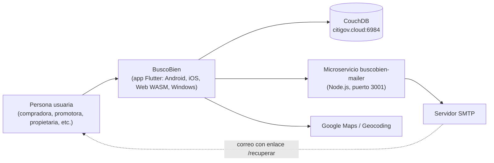
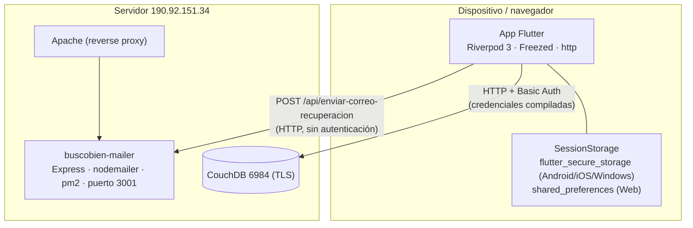
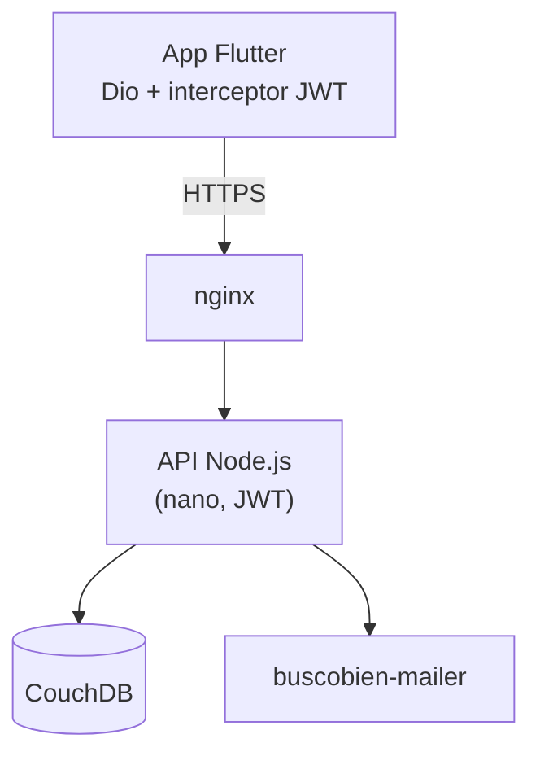
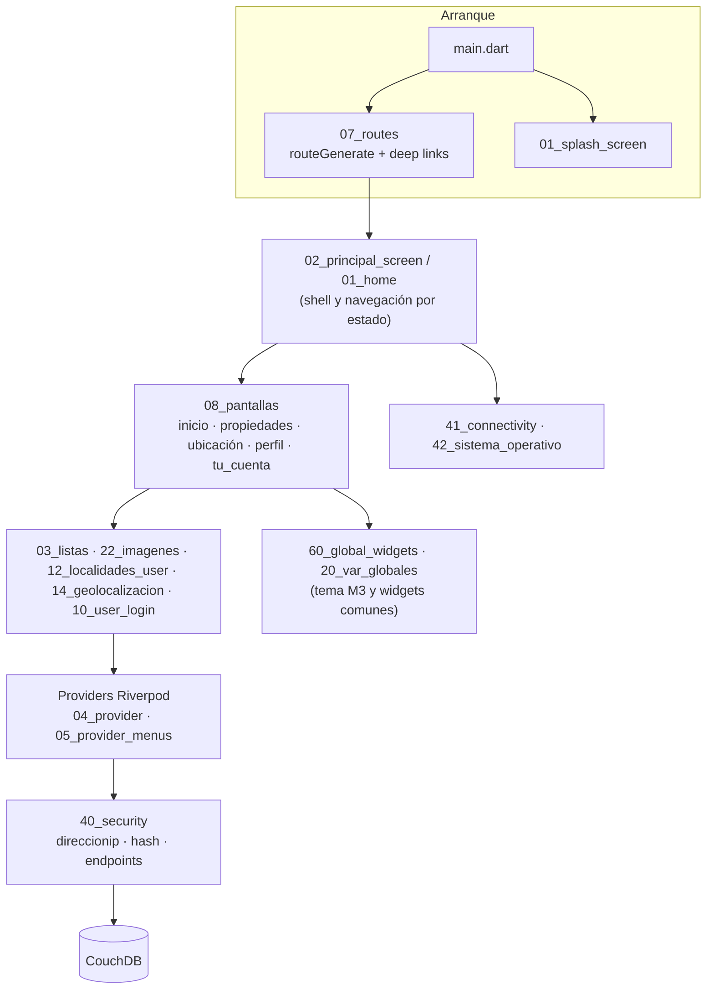

# Arquitectura C4 — Contexto y Contenedores

**Revisión de exactitud:** 2026-10-07, contrastado con `lib/`, `pubspec.yaml` y `server/`.  
**Alcance:** muestra la arquitectura **real** y la **objetivo** (pendiente de nginx + JWT). El detalle de capas está en [`arquitectura_general_buscobien.md`](arquitectura_general_buscobien.md).

## 1. Nivel 1 — Contexto

| Sistema externo | Uso verificado en el código |
| :--- | :--- |
| CouchDB | Todas las bases `buscobien_*` y `codigospostales` (ver [`bases_de_datos_en_codigo.md`](../06_modelo_de_datos_y_bd/bases_de_datos_en_codigo.md)). |
| `buscobien-mailer` | `POST http://citigov.cloud:3001/api/enviar-correo-recuperacion` (recuperación de contraseña). |
| Google Maps | `google_maps_flutter` y llamada a `maps.googleapis.com/maps/api/geocode` desde `14_geolocalizacion`. |
| FCM / notificaciones push | **No implementado**; solo `flutter_local_notifications` declarado en `pubspec.yaml`. |

## 2. Nivel 2 — Contenedores (estado real)

## 3. Nivel 2 — Contenedores (objetivo, pendiente)

La migración del estado real al objetivo está **pendiente** de la configuración de nginx y JWT. Hasta entonces no deben escribirse documentos que afirmen que el cliente no toca CouchDB. Riesgos asociados: [`modelo_de_amenazas.md`](modelo_de_amenazas.md).

## 4. Nivel 3 — Componentes de la app (por capas de `lib/`)

