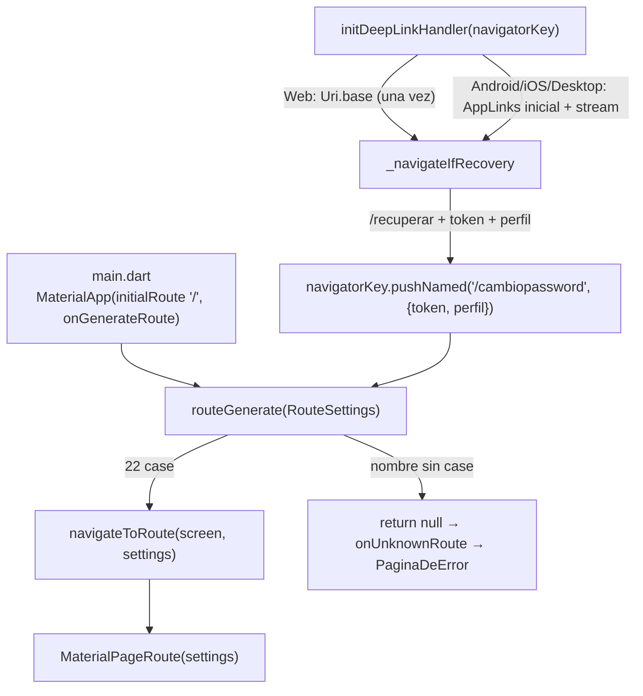

# SDD — Módulo 07_routes (BuscoBien)
## Especificación de diseño (EARS)

**Directorio fuente:** `lib/07_routes`  
**Archivos:** `app_routes.dart` (254 líneas), `deep_link_handler.dart` (56), `pagina_route_error.dart` (92), `routes_parameters.dart` (477)  
**Arquitectura:** `Navigator` 1.0 con `onGenerateRoute` único; sin GoRouter ni Navigator 2.0  
**Propósito:** catálogo de rutas con nombre, construcción de pantallas con argumentos tipados, deep link de recuperación de contraseña y plantillas globales de argumentos  
**Revisión de exactitud:** 2026-10-07, contrastado con el código  
**Trazabilidad:** requerimientos en [`epics_ears/07_routes.md`](../../../02_requerimientos/epics_ears/07_routes.md) (`REQ-ROUT-*`); escenarios en [`gherkin_bdd_scenarios/07_routes/`](../../../07_pruebas_y_calidad/gherkin_bdd_scenarios/07_routes/).

---

## 1. Visión general

| Archivo | Responsabilidad |
| :--- | :--- |
| `app_routes.dart` | Clase `AppRoutes` (22 constantes), `navigateToRoute` y `routeGenerate`. |
| `deep_link_handler.dart` | Detecta enlaces `/recuperar?token=…&perfil=…` y navega a cambio de contraseña. |
| `pagina_route_error.dart` | Widget `PaginaDeError(letrero)` de error genérico. |
| `routes_parameters.dart` | Clases de resultado/argumentos y variables globales de plantilla de argumentos. |

---

## 2. Requisitos de diseño

### 2.1 Catálogo de rutas (`AppRoutes`)
- **DES-ROUT-001:** El sistema deberá declarar las rutas como `static const String` en la clase `AppRoutes`, con 22 constantes.
- **DES-ROUT-002:** El sistema deberá resolver mediante `case` las 22 constantes: `main`, `splash`, `principal`, `plataforma`, `sinconeccion`, `checaconeccion`, `registro`, `listalocalidades`, `localidades`, `editaespacio`, `perfil`, `preferencias`, `gestionavatar`, `compraespacios`, `carouselfotospropiedad`, `fotospropiedad`, `fotospropiedadpaginada`, `agregamultiplesfotos`, `mapapropiedades`, `listaspropiedades`, `solicitarRecuperacion`, `cambioPassword`.
- **DES-ROUT-003:** Las 16 constantes que no tenían pantalla (`home`, `login`, `opciones`, `loginuser`, `localidad`, `gestionfotopropiedad`, `agregafotopropiedad`, `catalogotipotransaccion`, `filtrapropiedades`, `buscapropiedades`, `generadatapropiedades`, `generadatausuarios`, `generadatapromotores`, `gestionfotoscasa`, `fotospropiedadminiaturas`, `fotosagregafotoalista`) se eliminaron en MEJ-09; los flujos que las usaban (`/login` tras cambiar la contraseña, agregar/editar foto) se redirigieron a `/principal` y `/agregamultiplesfotos`.

### 2.2 Tabla de rutas activas

| Ruta | Constante | Pantalla | Argumento esperado |
| :--- | :--- | :--- | :--- |
| `/` y `/splash` | `main`, `splash` | `SplashPage(3, duration: 3, goToPage: PrincipalSliversMenuInicial())` | — |
| `/principal` | `principal` | `PrincipalSliversMenuInicial` | — |
| `/plataforma` | `plataforma` | `PaginaDetectaPlataforma` | — |
| `/sinconeccion` | `sinconeccion` | `PaginaSinConeccion` | `String` (mensaje) |
| `/checaconeccion` | `checaconeccion` | `PaginaChecaInternet` | `Map<String, dynamic>` |
| `/registro` | `registro` | `RegisterScreenUsers` | — |
| `/listalocalidades` | `listalocalidades` | `LocalidadesListScreen` | `int` (código postal) |
| `/localidades` | `localidades` | `PaginaBuscaLocalidadGMaps` | — |
| `/editaespacio` | `editaespacio` | `PaginaEditaEspacio` | `ValueEspaciosCasaGet` |
| `/perfil` | `perfil` | `PaginaPerfilWidget` | — |
| `/preferencias` | `preferencias` | `PaginaColores` | `String` (página de retorno) |
| `/gestionavatar` | `gestionavatar` | `GestionAvatares` | — |
| `/compraespacios` | `compraespacios` | `PaginaCompraEspacios` | — |
| `/carouselfotospropiedad` | `carouselfotospropiedad` | `PaginaCarouselFotosWidget` | `ValueEspaciosCasaGet` |
| `/fotospropiedad` | `fotospropiedad` | `PaginaFotosPropiedad` | `ValueEspaciosCasaGet` |
| `/fotospropiedadpaginada` | `fotospropiedadpaginada` | `PropiedadesListaFotosPromotor` | `ValueEspaciosCasaGet` |
| `/agregamultiplesfotos` | `agregamultiplesfotos` | `AgregaMultiplesFotos` | `Map<String, dynamic>` |
| `/mapapropiedades` | `mapapropiedades` | `PaginaMapaPropiedades(listaPropiedadesVar:)` | `EspaciosCasaGet` |
| `/listaspropiedades` | `listaspropiedades` | `PageMisListas` | — |
| `/solicitarrecuperacion` | `solicitarRecuperacion` | `PageSolicitarRecuperacion` | — |
| `/cambiopassword` | `cambioPassword` | `PageCambioPassword(token:, perfil:)` | `Map<String, String>` con `token` y `perfil` |

### 2.3 Resolución de rutas
- **DES-ROUT-004:** El sistema deberá registrar `routeGenerate` como `onGenerateRoute` de `MaterialApp` y usar `AppRoutes.main` como `initialRoute`.
- **DES-ROUT-005:** Cuando `routeGenerate` reciba un nombre con `case`, deberá construir la ruta con `navigateToRoute(screen, settings:)`, que devuelve `MaterialPageRoute` conservando los `settings`.
- **DES-ROUT-006:** `routeGenerate` deberá registrar con `debugPrintLevels(1)` el nombre y los argumentos de cada ruta, y `navigateToRoute` con nivel 2 el nombre.
- **DES-ROUT-007:** Cuando el nombre no tenga `case`, `routeGenerate` deberá devolver `null` y `MaterialApp` deberá usar `onUnknownRoute`, que muestra `PaginaDeError` con el nombre de la ruta.
- **DES-ROUT-008:** Cada `case` con argumentos deberá convertirlos con `as <Tipo>` sin verificación previa; un argumento ausente o de otro tipo deberá lanzar `TypeError` en tiempo de ejecución.
- **DES-ROUT-009:** Cuando la ruta sea `/cambiopassword`, `routeGenerate` deberá leer `args['token']!` y `args['perfil']!` de un `Map<String, String>`.

### 2.4 Deep link de recuperación de contraseña
- **DES-DEEP-001:** `main.dart` deberá invocar `initDeepLinkHandler(navigatorKey)` una sola vez, en `addPostFrameCallback` del primer frame.
- **DES-DEEP-002:** Cuando `kIsWeb` sea verdadero, el sistema deberá evaluar `Uri.base` una vez al arrancar y no escuchar cambios posteriores de URL.
- **DES-DEEP-003:** Cuando la plataforma no sea Web, el sistema deberá procesar `AppLinks().getInitialLink()` (arranque en frío) y suscribirse a `AppLinks().uriLinkStream` (arranque en caliente).
- **DES-DEEP-004:** Cuando el `path` de la URI contenga `/recuperar` y existan `token` y `perfil` no vacíos, el sistema deberá ejecutar `navigatorKey.currentState?.pushNamed(AppRoutes.cambioPassword, arguments: {'token': …, 'perfil': …})`.
- **DES-DEEP-005:** Si el `path` no contiene `/recuperar`, o falta `token` o `perfil` (o están vacíos), el sistema deberá ignorar el enlace sin mostrar mensaje.
- **DES-DEEP-006:** La verificación del `path` usa `contains('/recuperar')` y acepta cualquier host (producción o `localhost`).

### 2.5 Página de error
- **DES-ERR-001:** `PaginaDeError(letrero)` deberá mostrar un `Scaffold` con `AppBar` de 40 px (`appTheme.error`), el título «Error en la aplicación», el texto «Ocurrio el siguiente problema», el `letrero`, «Vuelva a intentarlo» y un botón «Salir» que ejecuta `Navigator.of(context).pop()`.
- **DES-ERR-002:** `PaginaDeError` deberá usarse desde `onUnknownRoute` (`main.dart`); no está registrada como ruta con nombre.
- **DES-ERR-003:** `principal_02_page_appbar.dart` deberá mostrar `PaginaDeError("Activa los permisos de ubicación")` con `Navigator.push` cuando falte el permiso de ubicación.

### 2.6 Argumentos y plantillas globales (`routes_parameters.dart`)
- **DES-PAR-001:** El archivo deberá definir `ResultadoGuardaFoto {statusCode, idFoto}`, `ResultSaveFoto {resultadoEnFotos, resultadoEnEspacios}`, `ArgumentsLocalidad {cp}` y `ArgumentsListaLocalidad {listaLocalidades, cp}`.
- **DES-PAR-002:** El archivo deberá definir 11 variables globales mutables: `parameterLocalidad`, `parametrosListaFotos`, `parameterEditaEspacio`, `parameterEditaFotos`, `inicializaValueGetCasa`, `parameterFotoPrincipal`, `parameterActualizaEspacio`, `parameterPaginaChecaConeccion`, `parameterCapturaFotosCasa`, `parameterPaginaMenuTipoTransaccion`, `parameterGestionFoto`.
- **DES-PAR-003:** Las plantillas `ValueEspaciosCasaGet` (`parameterEditaEspacio`, `parameterEditaFotos`, `inicializaValueGetCasa`, `parameterActualizaEspacio`) deberán mantenerse duplicadas con valores iniciales vacíos. Desde 2026-10-07 los campos de `datosdelcontactocasa` (nombre, teléfonos, correo) están vacíos en las tres plantillas (`parameterEditaEspacio`, `parameterEditaFotos`, `inicializaValueGetCasa`); antes contenían datos personales reales.
- **DES-PAR-004:** El uso externo de estas variables se concentra en `22_imagenes` (≈100 referencias), además de `02_principal_screen` y `08_pantallas/tu_cuenta/tus_espacios`.

---

## 3. Riesgos y deuda técnica

| Riesgo | Impacto | Recomendación |
| :--- | :--- | :--- |
| ~~`default: return null` sin `onUnknownRoute`~~ | **Resuelto** (MEJ-09) | — |
| ~~16 constantes sin pantalla~~ | **Resuelto** (MEJ-09): eliminadas | — |
| Casts `as` y `!` sin validar | `TypeError` en ejecución | Argumentos tipados (DTO/Freezed) con validación |
| Estado global mutable en `routes_parameters.dart` | Efectos cruzados entre pantallas | Reemplazar por argumentos inmutables o providers |
| Web solo procesa la URL al arrancar | Cambios de URL posteriores no navegan | Aceptable si el enlace siempre abre la app; revisar si se agregan más deep links |
| ~~Datos de contacto reales escritos en las plantillas~~ | **Resuelto** (2026-10-07): vaciado también en el resto de `lib/` | Solo permanecen en el historial de git (ver T12 en el modelo de amenazas) |
| ~~`PaginaDeError` no se muestra~~ | **Resuelto** (MEJ-09) | — |

---

## 4. Verificación

- Escenarios Gherkin: [`07_routes/`](../../../07_pruebas_y_calidad/gherkin_bdd_scenarios/07_routes/) y [`rutas_deep_links.feature`](../../../03_analisis_funcional/features_analisis/07_routes/rutas_deep_links.feature).
- Inventario técnico: [`inventario_07_routes.md`](../../../05_desarrollo_y_especificaciones_tecnicas/inventario_componentes/inventario_07_routes.md).
