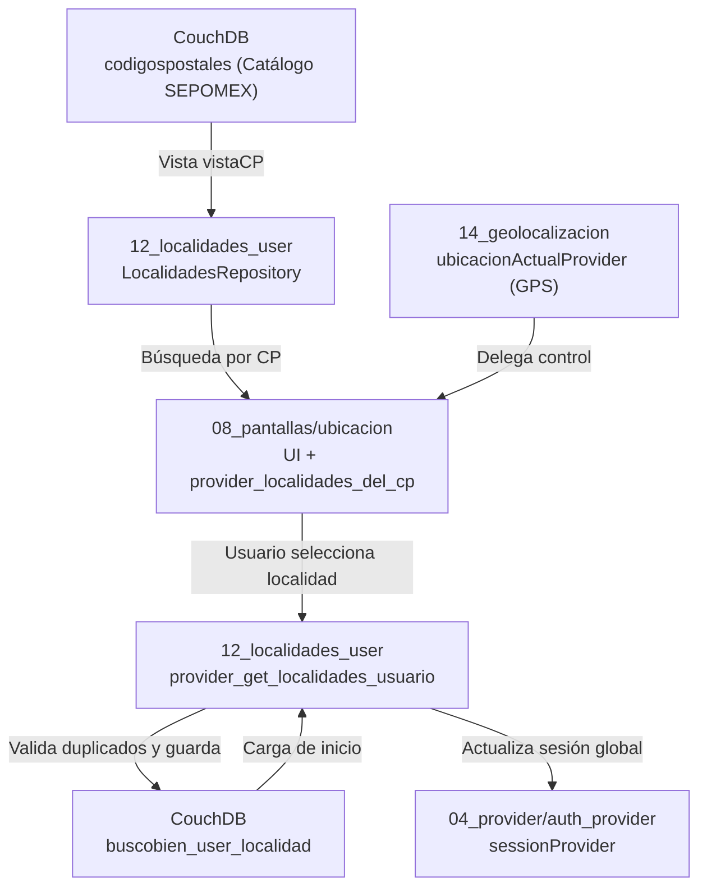

# Reporte de Ubicación y Localidades — Arquitectura, Cambios y Hallazgos

**Proyecto:** BuscoBien — Flutter / Riverpod / CouchDB  
**Fecha de los análisis:** 2026-05-23  
**Módulos:** `lib/12_localidades_user/`, `lib/08_pantallas/ubicacion/`

> Consolida los reportes anteriores «Reporte de Arquitectura: Módulos de Localización y Ubicación» y «Reporte de Cambios, Hallazgos y Recomendaciones — Módulo de Ubicación».

---

# Parte A — Arquitectura de los módulos de localización

---

### 1. Visión General de la Arquitectura

El sistema de localización de BuscoBien opera a través de un flujo centralizado, utilizando Riverpod para el estado reactivo, Freezed para la inmutabilidad de los datos, y CouchDB como base de datos documental.

---

### 2. Módulo `12_localidades_user` — Gestión y Repositorio

#### 2.1 Propósito
Maneja las localidades guardadas por los usuarios y encapsula la comunicación con CouchDB tanto para las ubicaciones del usuario como para el catálogo SEPOMEX.

#### 2.2 Inventario Principal
- **Modelos (Freezed):** `UsuarioLocalidades`, `UsuarioLocalidadesGet`, `RowsUserLocal`.
- **Repositorio:** `LocalidadesRepository` — Centraliza llamadas HTTP (`fetchUserLocalidades`, `fetchUserLocalid`, `saveUserLocalidad`, `fetchByCodigoPostal`).
- **Provider:** `ClassUserLocalNotifierProvider` — Notifier principal que gestiona la lista de localidades y sincroniza con el `sessionProvider`.

#### 2.3 Aspectos Clave
- **Inmutabilidad:** Uso exhaustivo de `@freezed` para evitar mutaciones no intencionadas.
- **Prevención de duplicados:** `LocalidadesRepository.saveUserLocalidad` consulta `vistaUserAsentamiento` de CouchDB antes de persistir, evitando duplicidades en base de datos al devolver un HTTP 409.
- **Sincronización:** Al seleccionar una localidad, el Notifier actualiza el `sessionProvider` para propagar la ubicación a filtros globales de búsqueda.

---

### 3. Módulo `08_pantallas/ubicacion/` — UI e Integración de Mapas

#### 3.1 Propósito
Provee las interfaces visuales para que el usuario busque códigos postales, visualice localidades, interactúe con Google Maps y gestione sus ubicaciones preferidas.

#### 3.2 Componentes Clave
- **UI de Búsqueda:** `PaginaBuscaLocalidadGMaps` (integra `GoogleMap` y delega control al `ubicacionActualProvider`).
- **UI de Listado:** `LocalidadesListScreen` (maestro de localidades de un CP) y `PaginaPrincipalListaLocalidades` (ubicaciones guardadas).
- **Modelos:** `LocalidadCp`, `LocalidadesGet` (Modelos Freezed compartidos para mapear respuestas SEPOMEX).
- **Providers:** `provider_localidades_del_cp` (gestiona solicitudes de CP y lista resultante).

#### 3.3 Aspectos Clave
- **Integración de Mapas:** Delega la gestión geográfica nativa al provider central de geolocalización.
- **Diseño visual:** Estricto uso de las variables de `appTheme` para consistencia UI en todos los widgets.

---

# Parte B — Cambios, hallazgos y recomendaciones

### 1. Análisis de la Funcionalidad (Uso y Procesos)

El sistema de localización y ubicación de Buscobien ha evolucionado hacia una arquitectura robusta, reactiva e inmutable. La funcionalidad se centra en los siguientes procesos clave:
1. **Consulta del Catálogo SEPOMEX:** Búsqueda eficiente de códigos postales y asentamientos a través de CouchDB, orquestado ahora por un repositorio unificado (`LocalidadesRepository`).
2. **Selección y Persistencia de Localidades del Usuario:** Permite a los usuarios mantener un directorio de ubicaciones frecuentes, previniendo la inserción de duplicados mediante validación proactiva contra CouchDB.
3. **Integración Cartográfica (UI):** Interfaz interactiva asistida por Google Maps para visualizar y seleccionar ubicaciones geolocalizadas con precisión, delegando el estado de la cámara y los marcadores al proveedor central `ubicacionActualProvider`.
4. **Sincronización Reactiva de Sesión:** Cualquier cambio que un usuario realice en su localidad preferida se propaga de manera inmediata mediante Riverpod al estado general de la aplicación (`sessionProvider`), asegurando que la interfaz y las consultas se contextualicen instantáneamente.

---

### 2. Reporte de Cambios (Evolución Arquitectural)

Al contrastar el estado actual de los módulos (`08_pantallas/ubicacion` y `12_localidades_user`) con los análisis técnicos anteriores, se evidencian mejoras arquitecturales fundamentales que han sido implementadas exitosamente:

*   ✅ **Resolución de Bugs Críticos:** Se corrigió el fallo grave en el pre-chequeo de duplicados. Actualmente, el `LocalidadesRepository` utiliza correctamente la vista `vistaUserAsentamiento` para validar si el par `[idUsuario, asentamiento]` ya existe, interceptando colisiones y devolviendo un error HTTP 409 antes de intentar cualquier inserción.
*   ✅ **Implementación de Inmutabilidad con Freezed:** Se migraron en su totalidad los modelos de datos (como `UsuarioLocalidades` y `LocalidadCp`) al generador de código `@freezed`. Esto solucionó fallos previos de serialización JSON y garantiza que el estado de Riverpod sea 100% inmutable, previniendo efectos secundarios.
*   ✅ **Centralización de la Capa de Datos (Red):** Se extrajeron las llamadas HTTP inline dispersas dentro de los Notifiers, concentrándolas en un nuevo y unificado `LocalidadesRepository`.
*   ✅ **Saneamiento y Eliminación de Deuda Técnica (Orphaned Code):**
    *   Se eliminó por completo el módulo inactivo `lib/50_localidades/` que duplicaba código.
    *   Se purgó el provider conflictivo y legacy `provider_user_localidades.dart`.
    *   Se eliminaron aproximadamente 800 líneas de código muerto/comentado del provider activo `provider_get_localidades_usuario.dart`, logrando un archivo significativamente más legible.

---

### 3. Hallazgos Actuales

La revisión a fondo del inventario actual revela un ecosistema saludable, con las siguientes observaciones:

*   **Buenas Prácticas en Separación de Responsabilidades:** El widget de Google Maps (`PaginaBuscaLocalidadGMaps`) no maneja su propio estado geográfico complejo. Delega esta responsabilidad limpiamente a componentes especializados en `14_geolocalizacion`, demostrando un excelente uso del patrón Provider.
*   **Consistencia en el Sistema de Diseño:** Las pantallas del flujo de ubicación evitan el hardcoding de estilos, recayendo en las variables temáticas centralizadas (`appTheme`).
*   **Código Comentado Residual:** Se identificó que, a pesar de la extensa limpieza, el archivo UI `pagina_busca_localidades_gmaps.dart` retiene un bloque de código masivo comentado (líneas 349 a 621), perteneciente a una iteración legacy previa a Riverpod.

---

### 4. Recomendaciones y Próximos Pasos

El estado actual del módulo de ubicación es excelente. Para cerrar la fase de saneamiento, se proponen las siguientes acciones menores:

1.  **Purgar Código Comentado en GMaps UI:** Eliminar de forma definitiva las líneas de código comentado en `lib/08_pantallas/ubicacion/pagina_busca_localidades_gmaps.dart`. Dado que el sistema reactivo opera de forma estable, mantener la versión antigua perjudica la legibilidad de la vista.
2.  **Unificación de Tipos de Coordenadas:** Evaluar a medio plazo la conveniencia de tipificar las coordenadas geográficas (`latitud`, `longitud`, `latDecimal`, `lonDecimal`) como valores numéricos `double` puros a través de todo el stack en lugar de depender de tipos `String`, facilitando cálculos nativos de radio y distancia sin requerir parseos constantes.
