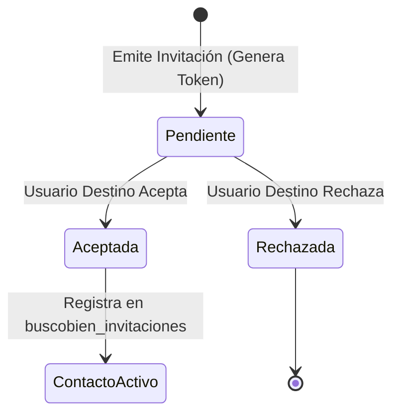

# Guía Operativa: Motor Social, Conocidos y Grupos — BuscoBien

**Fase de SDLC:** Etapa 8 — Operación, Guías y Despliegue  
**Módulos Clave:** `lib/08_pantallas/tu_cuenta/conocidos/`, `lib/08_pantallas/tu_cuenta/grupos/`  
**Última consolidación:** 2026-09-29  

---

## 1. Visión General del Motor Social

El **Motor Social** de BuscoBien transforma la experiencia inmobiliaria tradicional en una plataforma colaborativa. Permite a los usuarios conectarse mediante una red de **Conocidos** (relaciones 1:1) y **Grupos** (comunidades temáticas o regionales), facilitando el intercambio de propiedades, recomendaciones y mensajería en tiempo real.

---

## 2. Operación del Subsistema "Mis Conocidos"

### 1. Descubrimiento y Búsqueda de Contactos
- El usuario busca otros perfiles por nombre o correo electrónico en la pestaña *Conocidos*.
- El backend en Node.js consulta `buscobien_usuarios` evitando exponer datos privados.

### 2. Ciclo de Vida de Invitaciones (1:1)

### 3. Mensajería 1:1 y Listas Compartidas
- Una vez aceptada la conexión, se habilita la pestaña de chat in-app (`buscobien_mensajes`).
- Los usuarios pueden compartir listas de propiedades favoritas directamente en la conversación.

---

## 3. Operación del Subsistema "Mis Grupos"

### 1. Categorías de Grupos
- **Públicos**: Cualquier usuario registrado puede unirse y visualizar las publicaciones.
- **Privados**: Requiere invitación previa o aprobación del administrador del grupo.

### 2. Funcionalidades en Grupos
- **Muro de Publicaciones**: Fichas inmobiliarias compartidas por los miembros.
- **Tablón de Avisos**: Notificaciones fijadas por administradores.
- **Chat Grupal**: Mensajería multiterminal optimizada.

### 3. Colecciones CouchDB Involucradas
- `buscobien_grupos`: Definición del grupo, miembros y roles (`user:uuid`).
- `buscobien_invitaciones`: Tokens y estado de invitaciones grupales.
- `buscobien_mensajes`: Histórico de mensajes con `tipo: "grupal"`.
